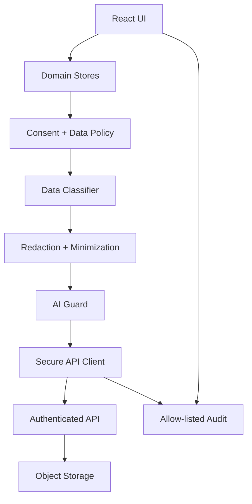
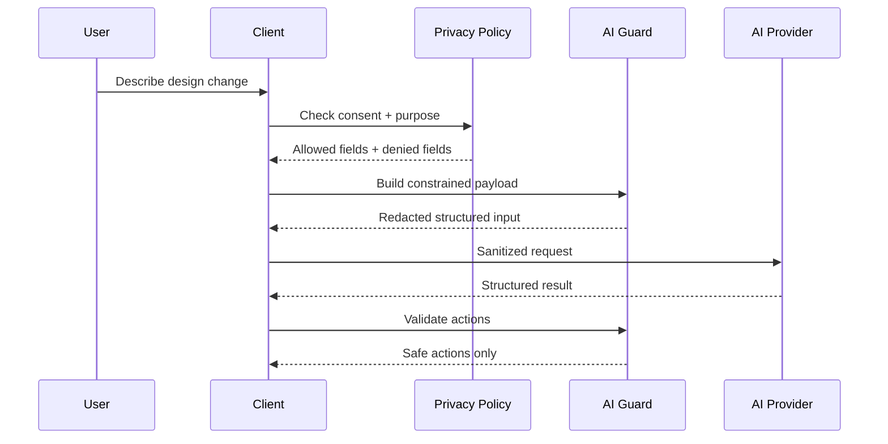

# RE:ROOM AI — Security, Privacy, State Management & Data-AI Hardening Pack

## Purpose

This pack is a drop-in architecture expansion for the `rerroom-ai` Vite/React 19 application in `lucylow/room-ai-interior-designer`.

The current repository describes a product that handles room imagery, videos, room layouts, user preferences, product activity, and contractor documents, and it explicitly calls for authenticated APIs, signed storage URLs, scoped tokens, deletion workflows, short-lived tokens, domain-specific stores, idempotent sync, server-side authorization, constrained AI actions, and avoiding sensitive logs. This pack turns those requirements into concrete client-side TypeScript modules while keeping the server boundary explicit.

## Important security boundary

The frontend is never the authority for authorization, billing, ownership, or deletion. Client checks are for UX and early failure only. Every sensitive server operation must be re-validated by the backend.

The web build also must not keep long-lived server secrets in `VITE_*` environment variables. `VITE_*` values are public to the browser.

## Included capabilities

- Domain-separated application state using `useSyncExternalStore`.
- Versioned state migrations and write-ahead mutation queue.
- Idempotency keys for sync mutations.
- In-memory authentication session with refresh coordination.
- Passphrase-locked encrypted local privacy vault using PBKDF2 + AES-256-GCM for browser-side user vault data.
- Secure-store abstraction for a future Expo / native keychain implementation.
- Data classification and purpose limitation.
- Explicit consent registry and consent-aware AI payload building.
- Prompt-injection detection for model-provided content and untrusted room notes.
- PII / secret redaction for telemetry and AI context.
- Safe structured AI action validation with bounded numeric values.
- AI data lineage records showing why a field was sent to an AI provider.
- Privacy-preserving room intelligence and deterministic demo mode.
- Secure API client with request IDs, timeout budgets, origin checks, and response envelopes.
- Sensitive-file validation and image re-encoding to reduce metadata leakage.
- Audit trail with allow-listed metadata.
- Privacy center UI and AI data inspector UI.
- CSP/security-header templates for Vite hosts.
- Threat-model fixtures and unit tests.

## Dependency philosophy

The pack intentionally avoids adding a large dependency surface. It uses browser Web Crypto, IndexedDB/localStorage adapters, React's `useSyncExternalStore`, and TypeScript. The only package change required is to keep the existing React/TypeScript toolchain; no runtime state-management dependency is mandatory.

## Recommended integration order

1. Copy `src/security`, `src/ai`, and `src/state` into the existing `rerroom-ai/src` tree.
2. Add `src/security/index.ts`, `src/ai/index.ts`, and `src/state/index.ts` exports.
3. Initialize the privacy store before enabling persistent room/design history.
4. Gate cloud AI calls through `DataAIController`.
5. Replace direct `fetch()` calls to AI/storage APIs with `SecureApiClient`.
6. Route upload processing through `image-sanitizer.ts` and `file-validation.ts`.
7. Add `<PrivacyCenter />` to Settings and a compact `<SecurityStatus />` to the main shell.
8. Use the state queue for offline room edits and generated design metadata.
9. Keep actual authorization, object ownership, signed URL issuance, quota enforcement, and deletion on the backend.
10. Add production CSP/security headers at the hosting layer.

## Security model



## AI data boundary



## Local vault design

For browser-side optional user vault data, the implementation derives a vault key from a user-supplied passphrase and uses AES-GCM with a fresh IV for each record. This is local data encryption, not a replacement for server password hashing. Server authentication passwords should be handled by the backend with a suitable password-hashing algorithm.

Web Crypto is available in secure contexts and exposes AES-GCM, PBKDF2, and related primitives. The implementation therefore deliberately uses authenticated AES-GCM and never stores the raw vault passphrase.

## Native migration path

For an eventual Expo/iOS build, replace `WebSecureStoreAdapter` with a platform adapter backed by iOS Keychain / Android Keystore. Do not copy browser localStorage semantics into a native production app. OWASP's mobile storage guidance specifically calls for secure storage of sensitive data and protection against accidental leakage through storage, logs, backups, and related APIs.

## AI safety rules

The model is not allowed to emit executable JavaScript, URLs to privileged endpoints, arbitrary SQL, or arbitrary tool names. It may produce only data that conforms to the `SafeAIAction` union. Numeric transforms are bounded. Target IDs must match known local objects. Unknown operations are rejected and recorded as policy violations.

## Demo mode

The included deterministic provider creates synthetic room-analysis results and AI actions. It never uploads images, never exposes secrets, and is deterministic for screenshots and demos. It should remain enabled only through an explicit feature flag.

## Verification checklist

```text
[ ] Type-check core security/state/AI modules
[ ] Unit-test crypto round trips
[ ] Unit-test consent denial paths
[ ] Unit-test redaction patterns
[ ] Unit-test prompt injection detection
[ ] Unit-test safe AI action bounds
[ ] Unit-test state persistence migrations
[ ] Unit-test idempotent sync queue
[ ] Test expired-session behavior
[ ] Test deletion workflow UI states
[ ] Verify AI API keys exist only on the server
[ ] Verify signed URLs expire
[ ] Verify logs exclude images, tokens, prompts, addresses
[ ] Verify CSP is active in production
[ ] Verify unsupported browser/device falls back safely
```

## Files

The pack intentionally separates concerns rather than placing everything in a single global store. The repository README already recommends domain-specific stores and explicitly says to avoid one massive mutable global object.
