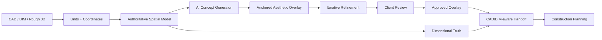
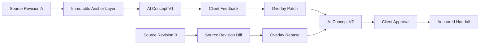

# RE:ROOM AI — CAD + BIM Remodel Workflow Extension

This continuation adds a **CAD/BIM-grounded remodeling architecture** on top of the previous security/privacy, visualization, and AI recommendation layers.

## Core invariant

> The imported CAD/BIM model is the dimensional source of truth. AI concepts are non-destructive overlays anchored to source features.

The AI can change material, color, furniture appearance, lighting intent, and proposed transformations without rewriting the underlying wall, opening, level, room, structural, or MEP source geometry.

## Workflow

## Supported source pathways

- DXF ASCII plan entities: lines, lightweight polylines and circles.
- IFC STEP metadata and semantic entity indexing for common architectural classes.
- OBJ geometry metadata.
- SVG plan geometry.
- glTF/GLB manifest ingestion.
- DWG/STEP are intentionally gated for a trusted server-side conversion path instead of pretending that a client parser is authoritative.

## Non-destructive concept model

A concept element points to an `AnchorReference`: `sourceDocumentId`, `sourceFeatureId`, optional external ID, and a confidence. Changes are stored as deltas or appearance operations. This lets a designer say:

- “Make the kitchen warmer.”
- “Try a walnut finish.”
- “Show a larger island option.”
- “Keep the existing windows.”
- “Give me three modern variants.”

The scene is **not rebuilt from scratch**. The previous concept becomes the parent of the next overlay, and refinements become patches.

## Handoff

The handoff builder carries source revision, source anchors, dimensional provenance, finish schedule data, quantities, warnings, and approval state. It produces annotation-oriented CAD output and structured handoff data. It does **not** claim code, engineering, permit, or field verification.

## Source-of-truth precedence

1. Explicitly approved surveyed / authoritative CAD/BIM dimension
2. Authoritative imported CAD/BIM property
3. Explicitly designer-confirmed measurement
4. Derived measurement
5. AI estimate / visual inference

AI estimates are never promoted automatically into authoritative construction dimensions.

## Validation

The generated continuation now contains **359 new TypeScript files** and **5508 TypeScript lines**, approximately **100.1 pages** at 55 lines per page, excluding this documentation.

The package is intentionally dependency-light so it can be merged into the existing Expo/React Native repository and then connected to its existing state, visualization, security, and AI layers.

## Additional implementation surface

The continuation now includes source revision diffing, stable revision lineage, spatial relationships, room topology, CAD semantic processors, BIM relation/property processors, non-destructive overlay operations, reusable AI concept templates, concept/refinement analysis, schedule builders, planning measurement tools, import/remodel demo scenarios, and server-boundary contracts.

### Revision-safe iteration

### Important implementation boundary

The included DXF/IFC ingestion is deliberately a practical starter layer, not a claim of complete industrial CAD/BIM geometry support. For DWG, STEP, full IFC geometry, native Revit databases, proprietary object metadata, or certified construction-document output, connect trusted server-side converters/parsers and retain their source provenance.
